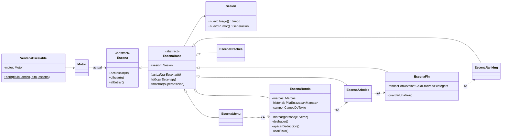
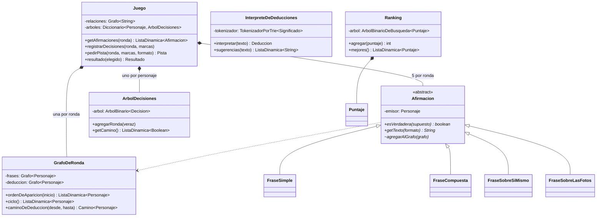
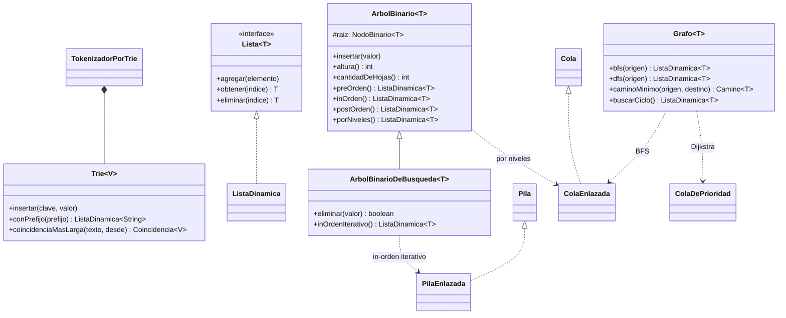
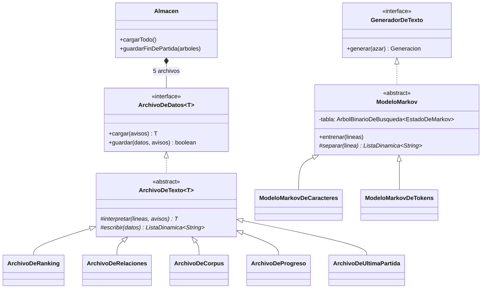

# Verdad o mentira

Juego de lógica que hicimos para la Game Jam II de Programación II (TUP, UTN FRRe). Hay
cinco personajes: dos siempre dicen la verdad, dos siempre mienten y uno hace las dos cosas.
En cada una de las tres rondas todos dicen una frase y hay que marcar quién miente. Al final
se elige al que cambió de una ronda a otra.

**Jugalo en el navegador:** https://verdad-o-mentira-five.vercel.app

**Informe técnico** (formato de los archivos, costo Big-O, salidas de Markov y decisiones de
diseño): [docs/devlog.docx](docs/devlog.docx)

## Integrantes

| Integrante | Qué programó |
| --- | --- |
| Medina Martínez, Emiliano Joel | `estructuras` y `grafos` |
| Zago, Valentín Ignacio | `arboles` y `tokens` |
| Hotchkyss, Gersom Tomás | `markov` y `juego.reglas.rumores` |
| Moreyra, Lautaro Román | `juego.reglas` (personajes, ronda, partida, deducción) y `juego.pantallas` |
| Grossetti, Ignacio Arturo | `persistencia`, `juego.reglas.registro` y `pruebas` |

Está hecho en Java 11 o superior, solo con la librería estándar. Lo armamos sobre el kit de
la cátedra ([jmgoya/Game-Java](https://github.com/jmgoya/Game-Java)) y usamos nuestras
propias Lista, Pila y Cola.

## Cómo se corre

| | Compilar | Jugar | Pruebas |
| --- | --- | --- | --- |
| Windows | `compilar.bat` | `ejecutar.bat` | `ejecutar.bat pruebas.PruebaEstructuras` |
| Linux / macOS | `./compilar.sh` | `./ejecutar.sh` | `./ejecutar.sh pruebas.PruebaEstructuras` |

El juego guarda todo en `datos/`. Si falta un archivo, lo crea de nuevo; si una línea está
rota, avisa en el menú y la saltea. La versión web (`web/`) corre el mismo `.jar` en el
navegador con CheerpJ: `bash web/construir.sh` arma el jar.

## Cómo está organizado

| Paquete | Qué hay |
| --- | --- |
| `motor`, `contratos`, `ui`, `verificador` | El kit de la cátedra, sin cambios |
| `estructuras` | `ListaDinamica`, `PilaEnlazada`, `ColaEnlazada`, `ColaDePrioridad`, `Diccionario` |
| `arboles` | Árbol binario genérico, ABB y trie |
| `grafos` | Grafo dirigido y ponderado: BFS, DFS, Dijkstra y ciclos |
| `tokens` | Tokenizador por coincidencia más larga sobre el trie |
| `markov` | Modelo de Markov de orden k (de 1 a 4), por caracteres o por tokens |
| `persistencia` | `Almacen` y un archivo de texto por tipo de dato en `persistencia.archivos` |
| `juego.reglas` | El juego sin pantallas, dividido en `personajes`, `ronda`, `partida`, `deduccion`, `rumores` y `registro` |
| `juego.pantallas` | Las escenas, la `Sesion` y la ventana escalable |
| `pruebas` | `PruebaEstructuras`, con 54 comprobaciones |

Las dependencias van en un solo sentido: las pantallas usan las reglas, las reglas usan las
estructuras y nada de abajo conoce a lo de arriba. No usamos ninguna colección de
`java.util`, y `java.io` aparece solo en `persistencia`.

## Pantallas y motor

El motor del kit llama 120 veces por segundo a `actualizar(dt)` y a `dibujar(g)` de la
escena activa. Cada pantalla hereda de `EscenaBase`, que maneja los botones y los carteles.
Se pasa de una pantalla a otra con `irA(escena)`.

`VentanaEscalable` reemplaza a la `Ventana` del kit, que es de tamaño fijo, sin modificarla.
Abre el juego maximizado y lo escala, tanto en la PC como en el navegador.

## Reglas del juego

`Juego` reparte los roles y arma cada ronda. Prueba frases al azar hasta que haya una sola
forma de marcar a todos sin contradicciones.

- **Frases.** Cada frase es una subclase de `Afirmacion` y sabe decir si es verdadera y cómo
  se dibuja en el grafo.
- **Grafo de la ronda.** `GrafoDeRonda` guarda dos grafos: el de quién habla de quién, que
  usa DFS para el orden de aparición, y el de deducción, que usa Dijkstra para las pistas.
- **Persistencia de las decisiones.** Las decisiones de cada personaje quedan en un
  `ArbolDecisiones`.

`InterpreteDeDeducciones` usa el trie para entender lo que escribe el jugador, por ejemplo
«lisa y mc lovin mienten, ferb dice la verdad». La coincidencia más larga hace que «dice la
verdad» le gane a «dice». El ranking es un ABB de los diez mejores puntajes: si entra uno
más, se elimina el peor.

## Estructuras, árboles y grafos

Todos los recorridos son recursivos, con el caso base en `nodo == null`, y devuelven una
`ListaDinamica`. La excepción es el in-orden iterativo del ABB, que usa una `PilaEnlazada`.

## Markov y persistencia

El modelo se entrena con `datos/corpus.txt` y genera los «rumores» que se ven en el menú y
en cada ronda. La tabla de transiciones es un ABB de estados. Si un contexto no tiene
sucesores, el modelo prueba con uno más corto, así nunca genera texto vacío.

Cada archivo de datos hereda de `ArchivoDeTexto`, que lee y escribe con
try-with-resources y hace una copia `.bak` antes de sobrescribir.

| Archivo | Qué guarda | Ejemplo de línea |
| --- | --- | --- |
| `ranking.txt` | El ABB del ranking en pre-orden | `185;7;Lauti` |
| `ultima-partida.txt` | Los árboles de la última partida en pre-orden, con `#` en los vacíos | `Roz;M;#;V;#;#;#` |
| `relaciones.txt` | El grafo de quién habla de quién, una arista por línea | `Lisa;Roz;3` |
| `corpus.txt` | Los rumores para entrenar el modelo | `Dicen que Lisa…` |
| `progreso.txt` | Partidas, rachas y configuración | `ordenDeMarkov=3` |
